# Noise-Robust Path Tracking for an Autonomous Mini-Drone

**Live app (open on a phone): https://rayonbiswas.github.io/minidrone-dsp-lab/**

*Using classical image processing and multi-sensor signal fusion. No AI or machine learning is used anywhere.*

- **Course:** Digital Signal Processing in Today's Era, VJTI (Veermata Jijabai Technological Institute), Mumbai
- **Also prepared for:** MathWorks Minidrone Competition India 2026
- **Report:** [docs/DSP_Project_Report.pdf](docs/DSP_Project_Report.pdf) · **Slides:** [docs/DSP_Project_Presentation.pptx](docs/DSP_Project_Presentation.pptx) · **Proposal:** [docs/DSP_Assignment_Proposal.pdf](docs/DSP_Assignment_Proposal.pdf) · **Demo videos:** [demo/](demo/)

## Demo

Short sped-up previews. Click a preview to open the full video.

**1. Path following with IMU, voice and camera** ([full video, 1 min 7 s](demo/1_path_following_imu_voice_camera.mp4))

[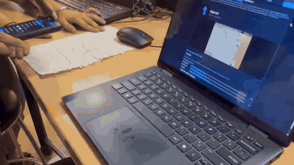](demo/1_path_following_imu_voice_camera.mp4)

| **2. Maze: shortest path from a photo** ([full video, 16 s](demo/2_maze_shortest_path.mp4)) | **3. Obstacle map in a corridor, Explore** ([full video, 2 min 26 s](demo/3_obstacle_map_corridor.mp4)) |
|:---:|:---:|
| [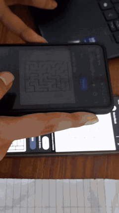](demo/2_maze_shortest_path.mp4) | [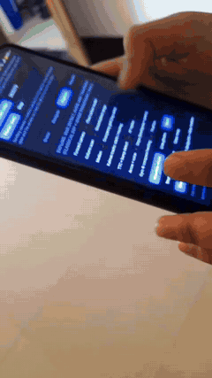](demo/3_obstacle_map_corridor.mp4) |

## Team

| Name | Roll number |
|---|---|
| Rayon Biswas | 241090016 |
| Zaid Faruqui | 241090024 |
| Piyush Patil | 241090053 |
| Hood Shaikh | 241090069 |
| Tanisha Nevrekar | 241091048 |
| Ananya Rane | 241091062 |
| Arpit k Rajput | 251090907 |

## Abstract

This project is a simulation study of noise-robust signal processing for an autonomous mini-drone. No drone hardware was built. A smartphone serves as the sensing platform: its camera, accelerometer, gyroscope and magnetometer provide real, noisy signals in place of a drone's on-board sensors. The processing runs in a browser-based app and is reproduced in MATLAB. Only classical digital signal processing and image-processing techniques are used.

One toolkit handles three tasks: (i) tracking a coloured line and detecting a landing marker; (ii) finding the shortest route through a maze from a single photograph; and (iii) detecting static and moving obstacles while moving through a corridor. Noise is injected on purpose, and every filter can be switched on or off, so the contribution of each stage can be measured on its own.

## Problem statement

A small drone navigates with a downward camera, an inertial measurement unit (IMU) and an altitude sensor, and every one of these signals is corrupted: camera frames suffer sensor noise, salt-and-pepper impulses, uneven lighting, glare and motion blur; the accelerometer is dominated by propeller vibration; integrated gyroscope rates drift; altitude readings carry random noise and outliers. A controller acting on these raw signals steers jerkily, drifts and makes false decisions.

**Goal:** design, implement and evaluate a classical DSP chain that extracts reliable navigation information from noisy camera, inertial and altitude signals, accurate enough to support line following, autonomous maze solving and obstacle avoidance.

## Pipeline overview

| Path | Processing chain |
|---|---|
| **Vision** (downward camera) | RGB → HSV colour threshold → median 3×3 → morphological close / open → edges → Hough transform → least-squares line refinement → line angle θ and offset d |
| **Inertial** (accelerometer + gyroscope) | FFT peak search → auto-tuned IIR notch at the vibration frequency → low-pass → atan2 roll / pitch → complementary or Kalman fusion with the gyroscope |
| **Altitude** | Median filter (removes outliers) → 1-D Kalman filter |
| **Closed loop** | Low-passed steering error → PID controller → simulated drone following the track |
| **Navigate / Follow track** | Directions from the track the camera sees ("Go straight", "Slight left", "Turn right", "Track lost", "Landing pad: stop"), with arrow and voice |
| **Maze solver** | Photo → find the maze and its walls → entrance / exit from gaps in the outer wall → **Dijkstra** shortest path (corridor middles, fewest turns among equally short routes) → drawn as a red line with Start and End |
| **Explore** | Floor colour model → per-column "virtual laser scan" from flat-floor geometry → log-odds **occupancy grid** → moving obstacles tracked with constant-velocity **Kalman** tracks → **time-to-collision** (TTC) warnings and bump detection → **A\*** route planning, replanned continuously |

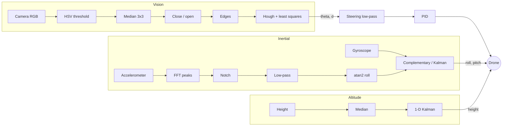

## Results

| Measure | Raw / untuned | With DSP chain |
|---|---|---|
| Line-angle error (RMS) | 1.84° | **0.31°** |
| Roll-angle error (RMS) | 14.2° | **0.95°** |
| Altitude SNR | 22.2 dB | **41.5 dB** |
| Steering command smoothness | baseline | **8× smoother** |
| Maze solver: true shortest path found | | **4 / 4** test mazes |
| Obstacle-avoidance runs reaching the goal | | **12 / 12** |

Full method, figures and discussion are in the [report](docs/DSP_Project_Report.pdf).

**Real camera frame, before and after tuning the vision chain** (true line angle 7.1°): untuned chain gives −12°, tuned chain gives 7.1°.

| Before | After |
|---|---|
| 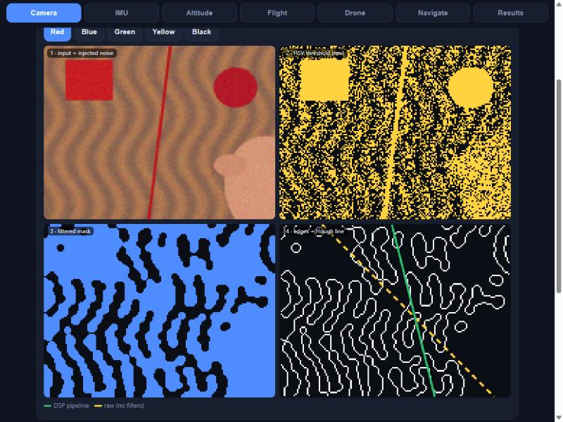 | 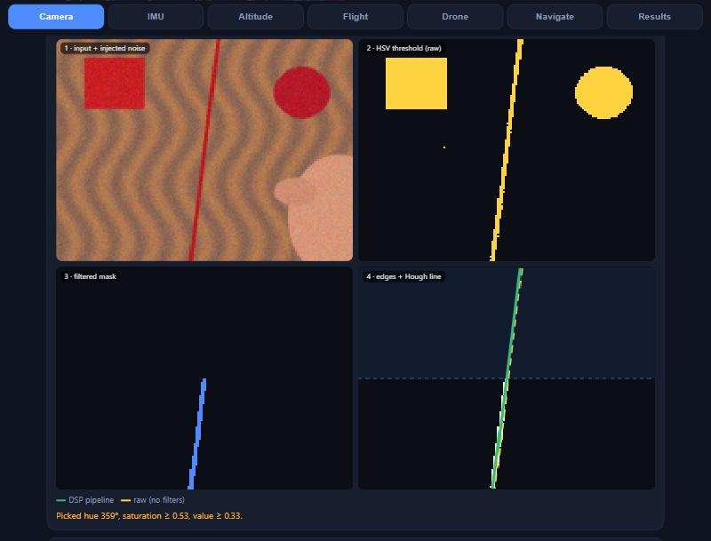 |

| | |
|---|---|
| 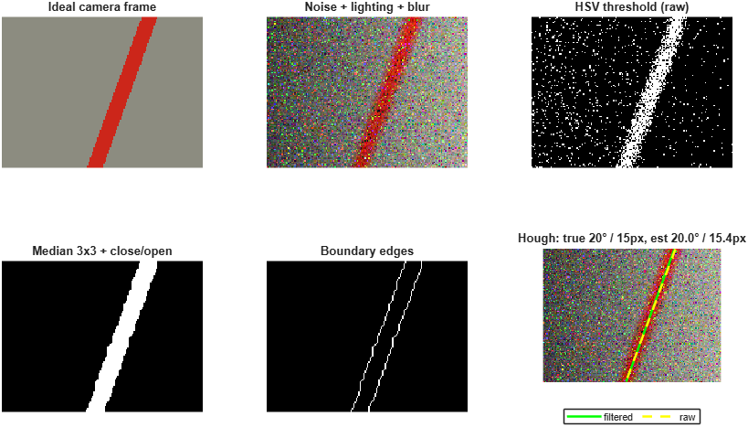 | 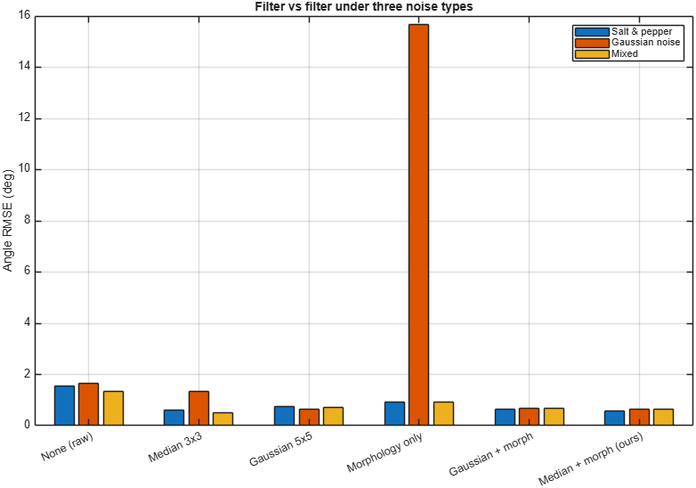 |
| 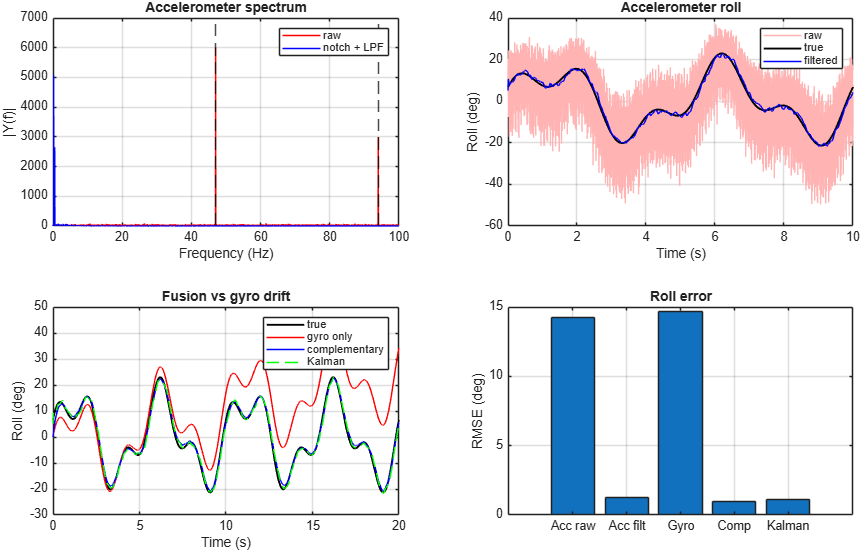 | 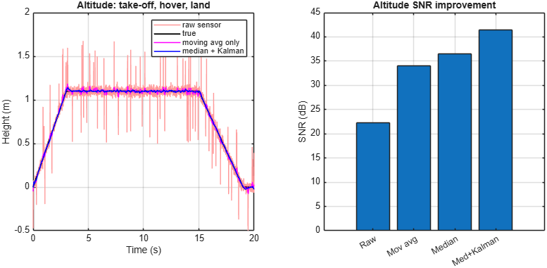 |
| 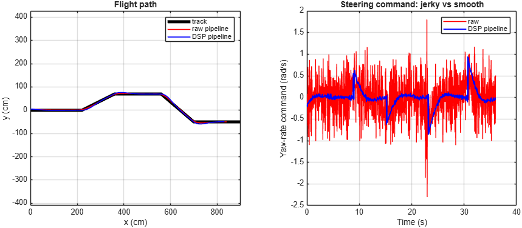 | 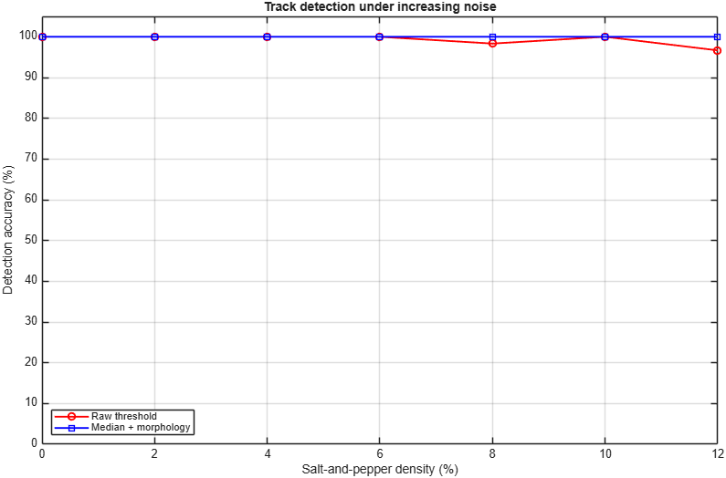 |

## How to use the app on a phone

1. Open **https://rayonbiswas.github.io/minidrone-dsp-lab/** in Chrome (Android) or Safari (iPhone). Nothing needs to be installed.
2. Allow camera and motion-sensor access when the browser asks. If the sensors are unavailable, the app falls back to simulated sensors.
3. Pick a tab:
   - **Camera:** choose *Phone camera*, point the back camera down at a coloured line (e.g. red tape), tap the line to pick its colour. The detected line, angle θ, offset d and steering bar appear. Switch the median / morphology filters off and on, and use the noise sliders, to see what each stage does.
   - **IMU:** tap *Start phone sensors*. Shows the FFT, the notch, and raw vs complementary vs Kalman roll.
   - **Altitude:** raw vs median vs Kalman height with injected noise and outliers.
   - **Flight:** closed loop, a raw drone and a DSP drone on the same noisy camera.
   - **Drone:** camera and IMU together (hold the phone flat, back camera down).
   - **Navigate → Follow track:** hold the phone flat ~30 cm above the track; arrow and voice directions follow the line.
   - **Navigate → Maze:** take or load a photo of a maze; the app draws the shortest path in red with Start and End. Test images are in [test_images/](test_images/).
   - **Explore:** hold the phone upright at chest height, back camera forward and tilted ~20° down, stand still on clear floor, press Start, tap a goal and walk. *Simulate room* runs the whole pipeline without moving.
   - **Results:** runs all comparisons with a fixed seed and lets you copy the tables or download CSV.
4. Optional: **Phone → Laptop** (top right) streams the phone's camera and sensors to the same page on a laptop for a big-screen demo.

## How to run the MATLAB scripts

No toolboxes are needed: the toolbox functions used (median filter, Hough, Butterworth, notch, FIR design and so on) are written out as local functions inside the scripts.

1. Open MATLAB and set the current folder to `matlab/`.
2. Run `minidrone_dsp_sim` (press Run, or step section by section with Ctrl+Enter). It produces the vision, inertial, altitude and closed-loop figures.
3. `esp32_mpu6050_analysis` analyses an IMU log (FFT, notch, FIR vs IIR, fusion, pole-zero, spectrogram). Without a recorded `mpu6050_log*.csv` it runs on a built-in, labelled simulated log.
4. `route_to_waypoints` turns a route CSV exported from the app (*Route → CSV* or *Path → CSV*) into `[x y z]` waypoints and yaw for the drone.
5. `phone_sensor_demo` runs the same pipeline on live phone data through MATLAB Mobile.
6. `simulink/test_simulink_blocks` checks the Simulink MATLAB Function blocks in plain MATLAB. See [matlab/simulink/README.md](matlab/simulink/README.md) for wiring them into the competition's minidrone model (that model itself needs the competition toolboxes).

## Repository structure

```
minidrone-dsp-lab/
├── index.html                  # the complete web app (served by GitHub Pages)
├── README.md
├── LICENSE
├── PLAN_A.md                   # demo plan
├── docs/
│   ├── DSP_Project_Report.pdf
│   ├── DSP_Project_Presentation.pptx
│   ├── DSP_Assignment_Proposal.pdf
│   ├── before_after.html
│   └── img/                    # figures used in this README and the report
├── demo/
│   ├── 1_path_following_imu_voice_camera.mp4
│   ├── 2_maze_shortest_path.mp4
│   ├── 3_obstacle_map_corridor.mp4
│   └── previews/               # animated previews shown in this README
├── matlab/
│   ├── minidrone_dsp_sim.m
│   ├── esp32_mpu6050_analysis.m
│   ├── phone_sensor_demo.m
│   ├── route_to_waypoints.m
│   └── simulink/               # MATLAB Function blocks + wiring guide
├── hardware/                   # optional ESP32 firmware (MPU6050 logger, beacons)
└── test_images/                # test frames and mazes for the app
```

## Scope

This is a **simulation study**. No drone hardware was built. A smartphone provides real sensor data (camera, accelerometer, gyroscope, magnetometer) and was moved by hand to emulate drone motion; some experiments use fully synthetic data with known ground truth. The MathWorks minidrone Simulink model is the intended target platform. The `hardware/` folder contains optional firmware for an ESP32 test rig.

## License

[MIT](LICENSE) © 2026 Rayon Biswas, Zaid Faruqui, Piyush Patil, Hood Shaikh, Tanisha Nevrekar, Ananya Rane, Arpit Rajput
